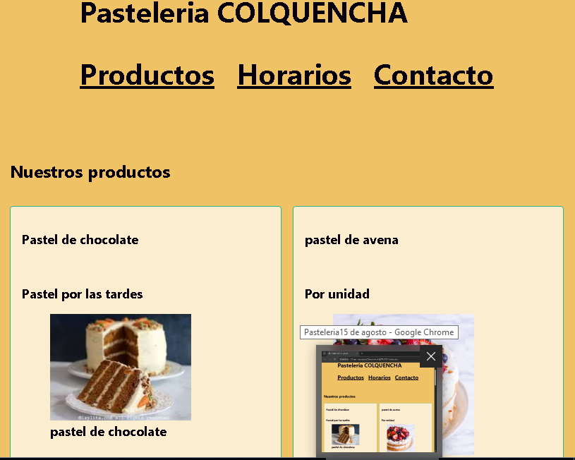

# Pastelería 16 de Agosto
**Estudiante:** Maura Mamani Fernandez  
**Cliente:** Karen, dueña de la pastelería  
**URL publicada:** Pendiente de publicación  

## Qué resuelve
La Pastelería 16 de Agosto todavía no es muy conocida, por lo que necesita mejorar la promoción y difusión de sus productos. A veces, los clientes tienen dificultades para conocer los pasteles disponibles, sus precios y las características de cada uno. Con la página web podrán consultar esta información de manera rápida y sencilla, ver la disponibilidad de stock y realizar pedidos en línea.

## Cómo está construido

- **Semántica:** El sitio web está desarrollado con HTML5 semántico. Se utilizó la etiqueta `<header>` para el encabezado principal y `<nav>` junto con listas (`<ul>`, `<li>`) para la barra de navegación (Productos, Horarios, Contacto). Se emplearon etiquetas `<section>` para agrupar los bloques temáticos de contenido (`#productos`, `#horarios` y `#pedido`). Las tarjetas de los productos se organizan mediante `<article>`. La información estructurada de horarios y precios se presenta en una `<table>` con `<caption>`, `<thead>`, `<tbody>` y encabezados `<th>`. Para el formulario de pedidos se utilizaron `<fieldset>` y `<legend>` organizando los datos del cliente y los detalles del pedido.
- **Layout:** Se utilizó **Flexbox** en el encabezado, navegación y controles para distribuir y alinear los elementos de manera flexible. Se empleó **CSS Grid** en la sección de productos para organizar las tarjetas del catálogo y permitir que se adapten dinámicamente a diferentes tamaños de pantalla.
- **Diseño:** Se definió una paleta basada en el color mostaza/naranja (`#e29a3c` / `#7a3f08` para garantizar un contraste accesible y legible) acorde a la identidad de la pastelería, complementado con verde (`#27b68b`) para bordes y acentos visuales.

## Capturas
  
*(Captura móvil 375px: Pendiente de publicación)*

## Lo más difícil
En la primera etapa, lo más difícil fue organizar y sincronizar las imágenes de los productos para que cada foto coincidiera exactamente con su nombre y descripción, además de lograr contrastes de color adecuados entre el texto y el fondo para asegurar una lectura cómoda.

---

## Laboratorio 2: JavaScript

En este laboratorio se integró la lógica en JavaScript organizada en módulos: **`app.js`** (estado inicial y aviso de stock), **`datos.js`** (catálogo de productos e inventario), **`funciones.js`** (cálculos de precios y descuentos), **`render.js`** (tarjetas dinámicas y manipulación del DOM) y **`eventos.js`** (buscador, filtros y validación del formulario). De este modo, los productos dejaron de estar fijos en el HTML y pasan a generarse e insertarse automáticamente en la página a partir de un arreglo de objetos según su disponibilidad.

Asimismo, se incorporó interactividad con eventos en tiempo real: búsqueda por texto y filtros por categoría (pasteles, dulces y salados) que actualizan el catálogo al instante mediante una función unificada. Además, el formulario de pedidos procesa los datos con `FormData` sin recargar la página (`preventDefault`), valida que la fecha de entrega sea válida y muestra una confirmación inmediata al cliente.

---

## Laboratorio 3: jQuery comparado con Vanilla JavaScript

Se incorporó el módulo **`jquery-comparado.js`** y la librería jQuery mediante CDN, permitiendo contrastar de forma directa las técnicas de:
- **Esperar al DOM:** `DOMContentLoaded` vs `$(document).ready()` / `$(function)`.
- **Selección y recorrido:** `document.querySelector` / `querySelectorAll` vs `$()` y `.each()`.
- **Lectura y escritura:** `textContent` / `innerHTML` vs `.text()` / `.html()`.
- **Manipulación de clases:** `classList` (`add`, `remove`, `toggle`, `contains`) vs `.addClass()`, `.removeClass()`, `.toggleClass()`, `.hasClass()`.
- **Eventos y efectos:** `addEventListener` vs `.on()` y métodos de animación como `.fadeOut()` y `.fadeIn()`.
- **Encadenamiento (Chaining):** Configuración de múltiples propiedades y clases en una sola instrucción.
- **Manejo de datos:** Métodos utilitarios como `$.each()`, `$.grep()` y `$.map()` aplicados al catálogo de productos de `datos.js`.
